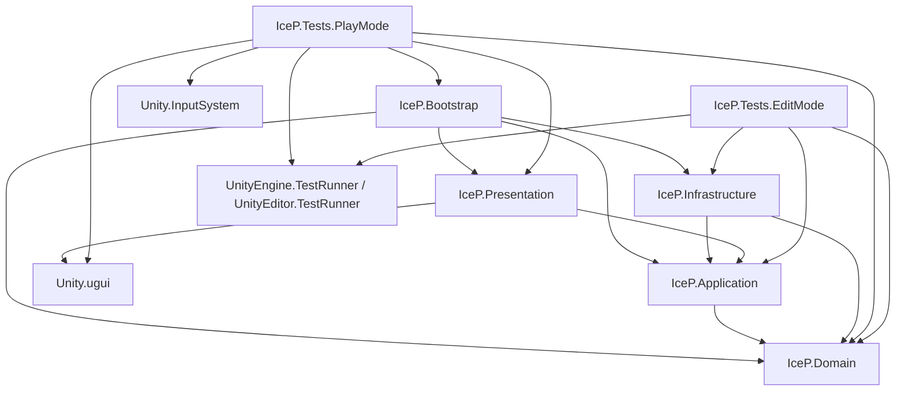

# IceP — sections 4.1–4.2 foundation

Requirements: Unity **6000.3.10f1**. Existing target: **Android**. Packages and
project settings are preserved; Test Framework, uGUI and Input System are already installed.
Specifications are in `Assets/Docs/TZ.md` and `Assets/Docs/Plan.md`.

Open `Assets/_Project/Scenes/SC.unity` and press Play. Startup shows Main Menu.
Play opens Slot; Back returns to Main Menu without scene loading. Settings and
Daily bonus open modal placeholders with Close buttons. No gameplay, rewards,
audio settings or persistence are implemented. Section 4.2 adds configuration
data and validation; it does not add spin generation or animations.

The original SC scene was moved to `Assets/_Project/Scenes/SC.unity`, keeping its
asset GUID and existing artwork. It is the sole enabled scene in Build Settings.
The section 4.1 navigation objects and bootstrap are integrated into SC.

`SlotBootstrapper` is the composition root. `GameNavigationService` is pure C#;
the presenter wires UI events and the MonoBehaviour view renders visibility.
Subscriptions are removed when the bootstrapper is destroyed. Before creating
the presenter, Bootstrap loads `SlotGameConfigSO` through `ISlotConfigProvider`
and `LocalSlotConfigProvider`, then validates the visual config. It retains an
immutable `SlotRuntimeConfig` snapshot. Invalid configuration reports field
diagnostics and prevents initialization/Play; there is no silent fallback.

Edit `Assets/_Project/Configs/SlotGameConfigSO.asset` for math/economy and
`SlotVisualConfigSO.asset` for sprites/artwork and future animation/effect data.
Both are assigned on SlotBootstrapper in SC. Settings are grouped in Inspector.
The five reel sequences are explicitly serialized. To edit their distribution,
update the required symbol counts and all five strips consistently (30 positions,
one Scatter per reel). Grid size 5 x 3 and weekly win limit 1 are v1 constraints.
Versions are non-blank opaque identifiers. Dates accept ISO 8601 UTC timestamps
with Z or +00:00; an empty date means no event boundary. Reset times are seconds
after 00:00 UTC. Configs holds assets and needs no assembly definition.

Runtime DTO collections are defensive copies wrapped for read-only access;
changing the SO or loading another snapshot cannot mutate a retained snapshot.
A future remote provider implements the same Unity-free `ISlotConfigProvider`
contract, returns a validated snapshot, and is selected by Bootstrap. No remote
integration or spin/bonus lifecycle is implemented yet.

Assembly arrows mean “references”:

Domain and Application use `noEngineReferences: true`. Runtime assemblies are
not auto-referenced by the legacy Assembly-CSharp scripts. The smoke test runs
in the Editor PlayMode Test Runner and checks startup, all navigation buttons,
modal interaction blocking, unchanged scene identity and scene reload cleanup.

Section 4.3 requires explicit approval before implementation.

For section 4.2 implementation details, all created/modified files, validation
checks and verification results, see `SECTION_4_2_REPORT.md`. Run
`IceP.Tests.EditMode` in the EditMode Test Runner and `IceP.Tests.PlayMode` in
the PlayMode runner. The scene test follows Inspector references, so the slot
screen may keep its existing name `GameScreen`. No Android build/device test
has been performed.

Implementation notes: the specifications were located under Assets/Docs rather
than the root. Duplicate test-runner references were corrected before the final
test run. A basic orthographic camera was added for URP overlay rendering. The
test tool's temporary editor play-mode setting change was restored. Existing
assets, settings, packages and uncommitted changes were preserved.
